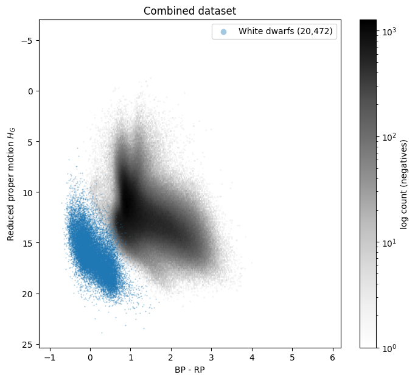
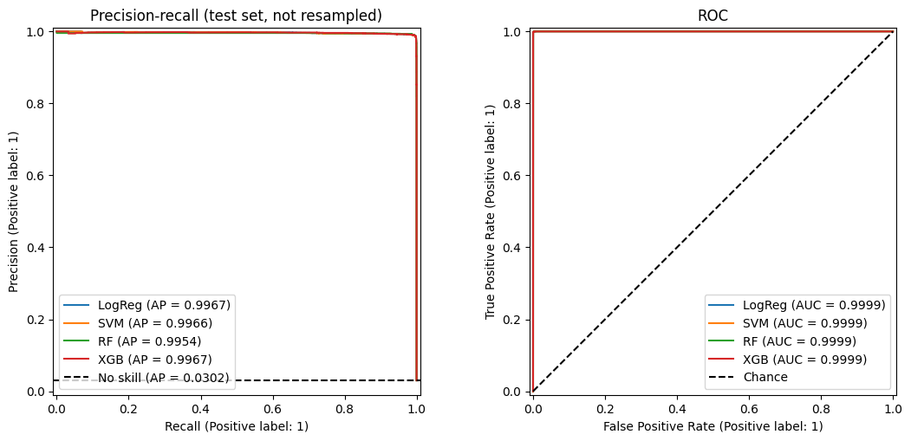
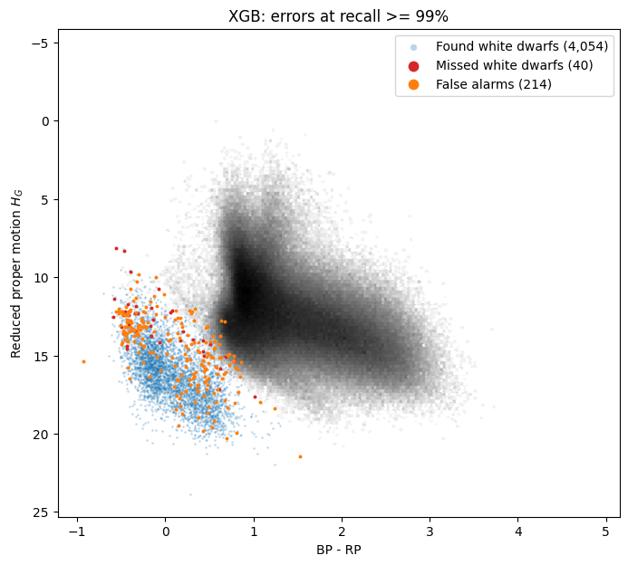
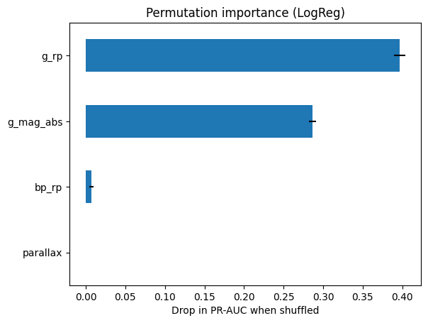

# White Dwarf Classification with Gaia: Mitigating Data Leakage

Finding white dwarfs among ~3 million Gaia DR3 stars using only Gaia photometry and astrometry,
with labels from SDSS spectroscopy and a focus on mitigating data leakage.

This is a machine-learning revisit of my undergraduate physics dissertation, *Identifying White
Dwarfs in the Gaia 3 billion star survey*, which used Gaia EDR3. This version uses Gaia DR3.

White dwarfs make up under 1% of the dataset, so this is a rare-object detection problem. A first
version scored a perfect PR-AUC of 1.0, and it was wrong. Most of the work went into finding out
why, and then into building a test set hard enough to mean something.

## Main findings

- XGBoost is the best model: PR-AUC 0.995, against 0.0067 for a no-skill classifier.
- At 99% recall it keeps 95% precision, with 214 false alarms / 606,100 test negatives.
- It correctly rejects 88% of the spectroscopic contaminants, objects that SDSS targeted as likely
  white dwarfs but that turned out not to be (95 / 785 flagged).
- Tree models outperform linear ones: PR-AUC above 0.99 for XGBoost and the random forest, about
  0.97 for logistic regression and the linear SVM.
- Recall is at least 98.4% for every white dwarf spectral type with more than 50 test objects.
- The original PR-AUC of 1.0 came from data leakage, not skill. Fixing the leaks, and making the
  selection identical for both classes, gave the realistic numbers above.



## Photometry, spectroscopy and astrometry

- **Photometry** measures how bright an object is through a few broad colour filters: Gaia's G, BP
  and RP bands. It's cheap, so Gaia has it for nearly 2 billion sources, but it only gives a coarse
  colour and brightness.
- **Spectroscopy** splits the light into many wavelengths and reveals absorption lines, which show
  what an object is made of. For example, hydrogen lines identify the most common type of white
  dwarf. It's slow and expensive, so only a small fraction of objects have spectra.
- **Astrometry** measures positions and motions on the sky: parallax (which gives distance) and
  proper motion (how fast a star drifts across the sky).

This project takes its labels from spectroscopy, which is the ground truth, and its features from
photometry and astrometry, which are available for everything. A model trained this way can
identify white dwarfs that have never been observed spectroscopically.

## Leakage traps

| Trap | What goes wrong | Fix |
|---|---|---|
| Circular labels | The usual white dwarf labels (`Pwd` from the Gentile Fusillo catalogue) are *defined* by position on the colour-magnitude diagram, which is built from the same quantities used as features. The model just learns the catalogue's selection boundary. This produced the original PR-AUC of 1.0. | Labels come from SDSS spectra (`spec_class`), which are independent of photometry. |
| Label-derived columns | `teff_*`, `logg_*`, `mass_*` and `Pwd`/`PHwd` are fitted on the assumption that the object *is* a white dwarf. | Excluded from the features. |
| Selection-function mismatch | The field stars come from a Gaia query with quality cuts; the spectroscopic sample doesn't. Distance, brightness or sky position then reveal *which catalogue* an object came from, not what it is. In the first version, a model given only parallax and apparent magnitude scored PR-AUC 0.84 from this alone. | Both samples are pulled from the same Gaia DR3 columns, and one function applies the field-star query's cuts to the spectroscopic sample. The notebook asserts that every field star passes it, so the two can't drift apart. |
| Duplicate spectra | 7,467 objects have several SDSS spectra, so copies of one star can end up in both train and test. | One row per object, keeping the highest-S/N spectrum. The 62 objects whose spectra disagree on the label are dropped. |
| Imbalance handled in the wrong order | Undersampling before the split gives a test set with a fake class balance and inflated metrics. | Split first (stratified), undersample only the training set (10:1), and fit the scaler on train only. The test set keeps the dataset's ~150:1 imbalance. |
| Negatives that are secretly positives | The field-star sample contains uncatalogued white dwarfs, and objects from the spectroscopic sample itself. | Every spectroscopic object is removed from the field stars, along with high-confidence catalogue white dwarfs (`Pwd > 0.75`). Lower-`Pwd` candidates stay in as hard negatives. `Pwd` is never a feature. |

## Data

| File | Rows | Role | Source |
|---|---|---|---|
| `gaiaedr3_wd_sdssspec.csv` | 42,007 spectra | Labels: white dwarfs and confirmed contaminants (STAR, QSO, GALAXY, CV) | `gaiaedr3_wd_sdssspec.fits.gz`: Gaia EDR3 white dwarf candidates cross-matched with SDSS DR16 spectroscopy (Gentile Fusillo et al. 2021) |
| `sdss_wd_ids.vot` | 32,321 | Unique `source_id`s of the spectroscopic sample, uploaded to the Gaia archive as a user table | Built from `gaiaedr3_wd_sdssspec.csv` (tracked in git) |
| `sdss_spec_gaiadr3.csv` | 32,321 | Gaia DR3 measurements for the spectroscopic sample | [`queries/sdss_spec_gaiadr3.sql`](queries/sdss_spec_gaiadr3.sql) |
| `gaia_field_pm.csv` | 3,031,564 | Field-star negatives | [`queries/field_v3_pm.sql`](queries/field_v3_pm.sql) |
| `gaiaedr3_wd_main.csv` | 1.28M candidates | Used only to clean likely white dwarfs out of the field-star negatives; never a feature | `gaiaedr3_wd_main.fits.gz`: Gaia EDR3 white dwarf candidate main catalogue (Gentile Fusillo et al. 2021) |

The two catalogue files are on the Warwick astronomy group's
[catalogue page](https://warwick.ac.uk/fac/sci/physics/research/astro/research/catalogues/), under
the Gaia EDR3 white dwarf candidates. They download as FITS and are converted to CSV with
`notebooks/01_fits_to_csv.ipynb`. The Gaia files come from the
[ESA Gaia archive](https://gea.esac.esa.int/archive/); each has its ADQL query in `queries/`.

The data files total about 3.3 GB and are not included in this repository. Provenance details,
label definitions and known data issues are in [`data/README.md`](data/README.md).

### Pipeline

```
SDSS spectra (42,007)
  → keep definite labels, one spectrum per object  →     30,383 objects
  → join Gaia DR3 data, apply the field-star cuts  →     20,472 white dwarfs + 3,773 contaminants
Gaia field stars (3,031,564)
  → remove spectroscopic objects (1,237) and catalogue WDs with Pwd > 0.75 (3,602)
                                                   →  3,026,725 field stars
Combined: 20,472 positives vs 3,030,498 negatives (0.67% positive)
```

The field stars are a uniform random subsample (about 5%) of everything that passes the query, so
the 0.67% positive share is set by the sampling fraction. Among all stars that pass the same cuts,
white dwarfs are much rarer.

### Selection cuts

Applied identically to both samples:

| Cut | Why |
|---|---|
| G < 20.7, G flux S/N ≥ 50, BP and RP flux S/N ≥ 10 | Good photometry, down to SDSS's depth |
| `ruwe` < 1.4 | Clean astrometric solution |
| Proper motion S/N ≥ 5 | Needed for reduced proper motion |
| \|b\| ≥ 20°, dec ≥ −10° | Approximate SDSS footprint, so sky position can't separate the samples |

There is deliberately no parallax cut; see [how the dataset evolved](#how-the-dataset-evolved).

### Features

- Reduced proper motion, H_G = G + 5 log₁₀(μ) + 5 = M_G + 5 log₁₀(v_t / 4.74), with μ in arcsec/yr
  and v_t the transverse velocity in km/s. It stands in for absolute magnitude without needing a
  parallax: white dwarfs still sit well below the main sequence.
- BP−RP and G−RP colours.
- Parallax, used as measured with no cut (it can be negative for distant stars).

## Results

Four models: L1 logistic regression, linear SVM, random forest and XGBoost. They're evaluated on a
held-out test set of 4,094 white dwarfs and 606,100 negatives (605,315 field stars and 785
spectroscopic contaminants), with no resampling. Each model uses its own threshold, set to the
highest value that still recovers ≥ 99% of white dwarfs, so recall is the same for all four by
design. Bold marks the best value in each column.

| Model | PR-AUC | Precision | Recall | MCC | False alarms per WD found |
|---|---|---|---|---|---|
| XGBoost | **0.9946** | 0.950 | 0.990 | 0.970 | 0.053 |
| Random forest | 0.9917 | **0.956** | 0.990 | **0.973** | **0.046** |
| Linear SVM | 0.9715 | 0.912 | 0.990 | 0.950 | 0.096 |
| Logistic regression | 0.9684 | 0.910 | 0.990 | 0.949 | 0.098 |

- **PR-AUC** (area under the precision-recall curve) summarises performance across every
  threshold. A no-skill classifier scores 0.0067, the share of white dwarfs in the test set.
- **MCC** (Matthews correlation coefficient) is a single score at the chosen threshold that uses all
  four cells of the confusion matrix: true and false positives, true and false negatives. It runs
  from −1 (always wrong) through 0 (no better than chance) to +1 (perfect). Unlike accuracy, it
  stays meaningful when one class dominates: labelling everything "not a white dwarf" would score
  over 99% accuracy here, but an MCC of 0.
- ROC-AUC is ≥ 0.9999 for every model. That's typical under heavy imbalance, which is why PR-AUC is
  the headline metric.

XGBoost ranks best across all thresholds (PR-AUC). The random forest is slightly better at the
99%-recall operating point.



### False alarms at 99% recall, by type of negative

| Model | Field stars flagged | Spectroscopic contaminants flagged |
|---|---|---|
| XGBoost | 119 / 605,315 | **95 / 785 (12%)** |
| Random forest | **80 / 605,315** | 108 / 785 (14%) |
| Linear SVM | 159 / 605,315 | 231 / 785 (29%) |
| Logistic regression | 177 / 605,315 | 222 / 785 (28%) |

### Discussion

- Tree models outperform linear ones. On the reduced proper motion diagram, the white dwarf
  sequence runs into the fast-moving halo population (see the figure at the top). XGBoost and the
  random forest reach PR-AUC above 0.99, while the linear models fall to about 0.97.
- The hard negatives are now mostly rejected. The spectroscopic contaminants are objects SDSS
  targeted because their colours looked like white dwarfs: 3,607 stars (mostly distant halo stars),
  157 cataclysmic variables and 9 quasars or galaxies. XGBoost flags 12% of them (95 / 785 in the
  test set). With ~3,000 contaminants in training (against 176 in v2), the models learn to reject
  them.
- False alarms cluster in two places: the hot, blue end of the sequence (BP−RP < 0), where hot
  subdwarfs also sit, and where the white dwarf sequence meets the halo population (BP−RP ≈ 0.5–1).
  Some field-star false alarms may be real white dwarfs missing from both catalogues.
- Missed white dwarfs are rare and spread out: 40 / 4,094 for XGBoost. Recall is ≥ 98.4% for every
  spectral type with more than 50 test objects (DA, DB, DC, DQ, DZ).



### Is parallax a shortcut?

In v2, parallax importance was ≈ 0, which confirmed the selection leak was closed. Here it's the
second most important feature (after BP−RP colour), so it needs checking. An ablation with XGBoost:

| Features | PR-AUC, full test set | PR-AUC, white dwarfs vs spectroscopic contaminants only |
|---|---|---|
| All four | 0.995 | 0.997 |
| Without parallax | 0.975 | 0.989 |
| Parallax only | 0.132 | 0.990 |
| Colours only | 0.773 | 0.907 |

Parallax alone is nearly useless against field stars (0.13), so it isn't the survey shortcut that
broke v1. Its value is in separating white dwarfs (median parallax 3.6 mas) from the distant halo
stars among the contaminants (median 0.13 mas). That's physics: a faint blue object with no
measurable parallax is too far away to be a white dwarf. Without parallax, PR-AUC drops only to
0.975, so the model doesn't depend on it. One caveat is in [Limitations](#limitations).



## How the dataset evolved

| | v1 | v2 | v3 (current) |
|---|---|---|---|
| Field-star selection | parallax ≥ 2.5 mas (≤ 400 pc), 5% parallax precision | parallax ≥ 1 mas (≤ 1 kpc), 20% parallax precision | No parallax cut; proper motion S/N ≥ 5, `ruwe` < 1.4, SDSS footprint |
| Spectroscopic white dwarfs kept | 6,831 | 17,794 | 20,472 |
| Spectroscopic contaminants kept | 46 | 224 | 3,773 |
| Field stars | 2,973,291 | 572,090 | 3,026,725 |
| Best PR-AUC | 0.994 (random forest) | 0.997 (logistic regression) | 0.995 (XGBoost) |
| No-skill PR-AUC | 0.0023 | 0.030 | 0.0067 |
| Test contaminants flagged as white dwarfs (best model, 99% recall) | 7 / 11 | 25–26 / 48 | 95 / 785 |

PR-AUCs aren't directly comparable across versions, because the share of positives differs. What
changed is the difficulty and size of the hard-negative set.

v1 → v2, the culling problem: matching the v1 cuts closed the selection leak, but kept only 27% of
the spectroscopic white dwarfs and 1% of the contaminants. White dwarfs are intrinsically dim: SDSS
white dwarfs have a median apparent G of 19.4, where Gaia's parallax error is ~0.34 mas, so 5%
precision needs a parallax above 6.8 mas, or being within ~150 pc. Contaminants failed because they
are far away (median parallax 0.26 mas). v2 loosened the parallax cuts, at the cost of noisier
absolute magnitudes.

v2 → v3, dropping parallax cuts: even v2 kept only 224 contaminants. Most are halo stars thousands
of parsecs away, or quasars and galaxies, whose parallaxes are noise, so no parallax-based cut can
keep them. Proper motion can: for a typical disk star, the proper motion in mas/yr is several times
the parallax in mas, and Gaia measures both to similar precision. v3 cuts on proper motion instead
and replaces absolute magnitude with reduced proper motion. It also pulls the spectroscopic sample's
Gaia data through a user-table join, so both samples are cut on identical columns, and adds a `ruwe`
cut and a sky-footprint cut to both.

All queries are in [`queries/`](queries/). The v2 notebook and results are in the git history.

## Limitations

- Artificial class balance: the field stars are a random subsample, so the 0.67% white dwarf share
  is set by the sampling fraction. Among all stars that pass the cuts, white dwarfs are far rarer,
  so the same model would have lower precision at 99% recall. Recall doesn't depend on it.
- Inherited candidate preselection: the spectroscopic sample consists of Gentile Fusillo catalogue
  candidates, which were selected using parallax-based absolute magnitudes. Both its white dwarfs
  and its contaminants passed that preselection; the field stars didn't. Part of parallax's
  importance may reflect this rather than physics alone.
- Threshold chosen on the test set: recall is fixed by construction and precision is slightly
  optimistic. A separate validation split would remove this.
- Approximate sky matching: the footprint cut is a box (|b| ≥ 20°, dec ≥ −10°), not SDSS's actual
  footprint. Matching on HEALPix pixels that contain spectroscopic objects would be exact.
- SDSS-selected samples: the white dwarfs and contaminants are whatever SDSS chose to observe, not
  representative populations, and that targeting can't be reproduced for the field stars.
- Scope: the results apply to stars with G < 20.7, measurable proper motions and clean astrometry,
  at high galactic latitude. Slow-moving distant objects, such as quasars, are mostly excluded by
  the proper-motion cut.

## Future extensions

### White dwarf spectral subtypes

A second stage, planned for [`notebooks/03_wd_subtypes.ipynb`](notebooks/03_wd_subtypes.ipynb),
would classify confirmed white dwarfs by primary spectral type, which is set by the lines in their
spectrum:

| Type | Spectrum | White dwarfs available (v3 cuts) |
|---|---|---|
| DA | Hydrogen (Balmer) lines | 15,652 |
| DC | No lines | 1,942 |
| DB | Neutral helium lines | 1,455 |
| DZ | Metal lines | 563 |
| DQ | Carbon features | 293 |
| DO | Ionised helium lines | 53 |

The plan, following García-Zamora et al. (2025):

- Two tasks: DA vs non-DA, then DB / DC / DQ / DZ among the non-DAs. DO is too small to learn
  reliably.
- Features: Gaia's broad bands barely see spectral lines, so this stage would add the SDSS ugriz
  photometry already in the spectroscopic file. The u band covers the Balmer jump, the classic
  photometric DA / non-DA indicator. The atmosphere-fit columns (`teff_*`, `logg_*`, `chisq_*`)
  stay excluded: comparing hydrogen and helium fits effectively gives the answer away.
- Evaluation: stratified 5-fold cross-validation, since DQ and DZ have only a few hundred objects,
  with per-class recall and precision, macro F1 and balanced accuracy.

### Other extensions

- Gaia XP spectral coefficients: Gaia's low-resolution spectra, the input García-Zamora et al. use.
  They could separate DQs, DZs and cataclysmic variables better than broadband colours, if enough of
  this sample has them (check `has_xp_continuous`). They would need normalising by brightness, or
  they would reintroduce the SDSS-targeting shortcut.
- A validation split for choosing the threshold, so test-set precision is unbiased.
- Exact sky-footprint matching with HEALPix pixels.
- More hard negatives from other spectroscopic surveys, such as hot subdwarf and cataclysmic variable
  catalogues.

## Reproducing

1. Create an environment (developed with Python 3.10):
   ```
   pip install -r requirements.txt
   ```
   `astropy` is only needed for the FITS conversion, and `mlflow` only for run tracking.
2. Download `gaiaedr3_wd_main.fits.gz` and `gaiaedr3_wd_sdssspec.fits.gz` from the
   [Warwick catalogue page](https://warwick.ac.uk/fac/sci/physics/research/astro/research/catalogues/)
   into `data/raw/`. Convert each one with `notebooks/01_fits_to_csv.ipynb` by setting `fits_path`
   to it. The CSVs are written to `data/` under the names the analysis notebook loads.
3. Log in to the [Gaia archive](https://gea.esac.esa.int/archive/) and upload `data/sdss_wd_ids.vot`
   as a user table named `sdss_wd_ids`.
4. Run [`queries/sdss_spec_gaiadr3.sql`](queries/sdss_spec_gaiadr3.sql), with your username filled
   in, and save the result as `data/sdss_spec_gaiadr3.csv`.
5. Run [`queries/field_v3_pm.sql`](queries/field_v3_pm.sql) and save the result as
   `data/gaia_field_pm.csv`.
6. Run `notebooks/02_wd_classification.ipynb` top to bottom, from the `notebooks/` folder: data paths
   are relative to it. The final section logs runs to an MLflow server at `localhost:5000`. Set
   `USE_MLFLOW = False` to skip it, or start a server from the repository root with
   `mlflow server --port 5000`.

All random seeds are fixed, and `random_index` is fixed in DR3, so the same query returns the same
field stars and a re-run reproduces the numbers above.

## Repository contents

```
├── notebooks/
│   ├── 01_fits_to_csv.ipynb          FITS → CSV conversion for the Gentile Fusillo catalogue files
│   ├── 02_wd_classification.ipynb    Full analysis: labelling, selection matching, features, modelling, evaluation
│   └── 03_wd_subtypes.ipynb          Spectral subtype classification (planned, not started)
├── queries/                          ADQL queries for the Gaia archive, one per data file
│   ├── sdss_spec_gaiadr3.sql         Gaia DR3 data for the spectroscopic sample (user-table join)
│   ├── field_v3_pm.sql               Field stars, proper-motion cuts (current)
│   ├── field_v2_1kpc.sql             v2: field stars within 1 kpc
│   └── field_v1_400pc.sql            v1: field stars within 400 pc
├── data/                             Not tracked (≈ 3.3 GB), apart from the notes and the upload file
│   ├── README.md                     Data notes: provenance, columns, labels, cuts, known issues
│   ├── sdss_wd_ids.vot               Spectroscopic source_ids for the Gaia archive upload
│   ├── raw/                          FITS downloads
│   └── *.csv                         Converted catalogues and the Gaia query outputs
├── figures/                          Figures used in this README
├── requirements.txt
└── LICENSE
```

## References

- García-Zamora, E. M. et al. (2025). A random forest spectral classification of the Gaia 500 pc
  white dwarf population. *A&A*, 699, A3.
- Gentile Fusillo, N. P. et al. (2019). A Gaia Data Release 2 catalogue of white dwarfs and a
  comparison with SDSS. *MNRAS*, 482, 4570. [arXiv:1807.03315](https://arxiv.org/abs/1807.03315)
- Gentile Fusillo, N. P. et al. (2021). A catalogue of white dwarfs in Gaia EDR3. *MNRAS*, 508, 3877.
- Gaia Collaboration, Vallenari, A. et al. (2023). Gaia Data Release 3: Summary of the content and
  survey properties. *A&A*, 674, A1.

This work uses data from the European Space Agency mission *Gaia*, processed by the Gaia Data
Processing and Analysis Consortium (DPAC), and from the Sloan Digital Sky Survey.

## License

The code in this repository is released under the [MIT License](LICENSE). The data comes from the
sources listed above and is covered by their own terms.
